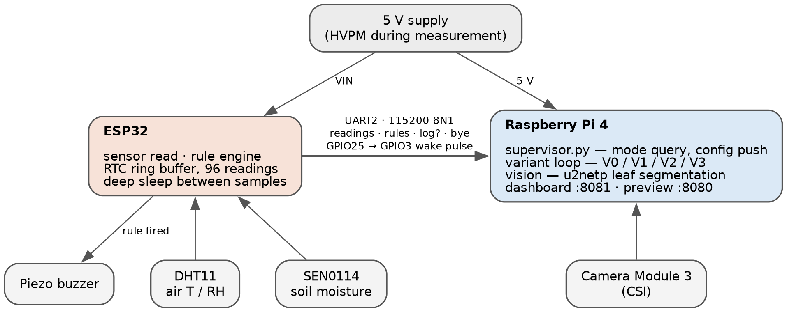
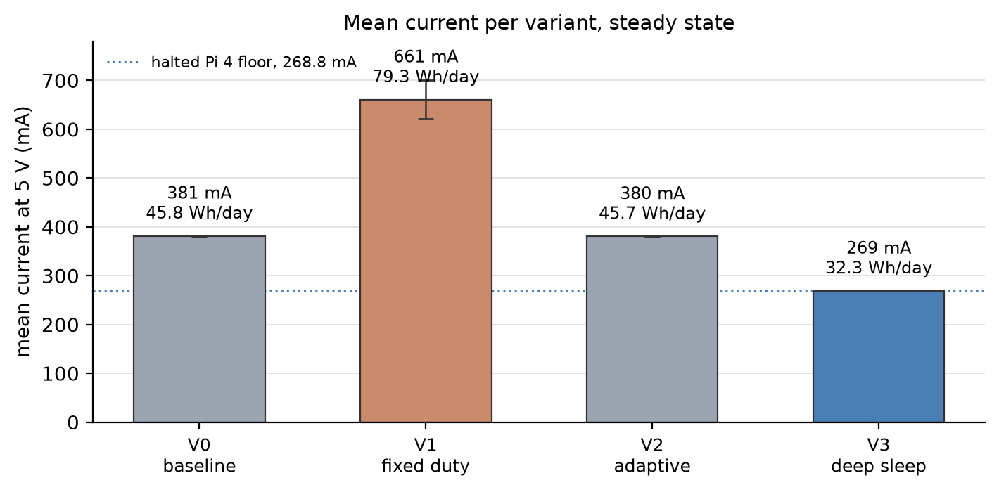

<!-- _class: lead -->

# Smart Plant Monitor

### An energy ladder for a two-board sensor node

 

**Miha Rene** and **TEAMMATE** · FRI, IoT 2026 · 23 November 2026

<!--
0:00  Title. 10 s.
-->

---

## What it is

A plant that says when it needs water, and photographs its own leaves.

- **ESP32** — reads air temperature/humidity and soil moisture, evaluates the
  rules locally, sleeps between samples
- **Raspberry Pi 4** — camera, leaf segmentation, dashboard, event log
- The two talk over **UART2**; the ESP32 can wake the Pi with a pulse on
  **GPIO25 → GPIO3**

 

Everything below is about how little energy that can take.

<!--
0:10  What it is. 40 s.
-->

---

## Architecture

<!--
0:50  Block diagram. 50 s. Point at the two boards, the UART2 link, the wake
      line, and the fact that the Pi is powered off most of the time in V3.
-->

---

## Where the energy goes

The Pi is the whole game. We measured it rather than assumed it:

| | mean current |
|---|---|
| V0 — ESP32 samples every **2 s** | 381.4 mA |
| V2 — ESP32 samples every **10 s**, adaptive | 380.5 mA |

A **5× change** in the ESP32's duty cycle moved the total by **0.2%**.

 

So the only lever that matters is whether the Pi is on.

<!--
1:40  The key insight. 40 s. This is the slide that sets up everything else.
-->

---

## Solutions we considered

**Implemented**

- **Hierarchical sensing** — rules run on the ESP32, so the Pi only wakes when
  something is worth reporting (V2, V3)
- **Sampling rate adjustment** — adaptive fast/slow interval (V2)
- **Fixed duty cycling** — camera every 60 s (V1)
- **Deep sleep + Pi halt** — the Pi is powered off between events (V3)

**Rejected**

- **Power the Pi off entirely** — it has to stay wakeable, so it can only halt
- **MCU only, no Pi** — no camera, and the leaf check is the point
- **Always-on camera** — measured, and it is the worst rung (V1)

<!--
2:20  Solutions considered. 50 s. Say plainly that V1 was a mistake we kept
      because it is the honest comparison.
-->

---

## The four variants

| | ESP32 | Pi | Camera |
|---|---|---|---|
| **V0** baseline | samples every 2 s, always awake | always on | never |
| **V1** fixed duty | samples every 60 s | always on | every 60 s |
| **V2** adaptive | adaptive 10 s / 600 s, rules on the ESP32 | always on | heartbeat |
| **V3** deep sleep | deep sleeps, wakes on its timer | **halted**, woken by the ESP32 | per wake |

 

Same sensors, same rules, same log format. Only the energy
strategy changes, so the comparison is fair.

<!--
3:10  The ladder. 50 s.
-->

---

## How we measured

- **Monsoon HVPM** at 5 V, feeding the whole rig
- **3 captures per run**, 180 s each, steady state only
- **Null test** with nothing connected: **−0.03 mA** — the meter has no offset
- V3's captures start with the Pi still booting, so the idle figure comes from
  the steady window, not the file average

 

Raw captures and the summary script are in the repository
under measurement/.

<!--
4:00  Method. 40 s. The null test is worth one sentence: it is what makes the
      numbers defensible.
-->

---

## Results

<!--
4:40  Results. 60 s. Read the four numbers, then point at the dotted line.
-->

---

## Why 29%, not 95%

V3's idle is **268.8 mA**. That is the whole of it.

- With the ESP32 **unplugged**: 268.8 mA
- With it deep sleeping and sampling: 268.8 mA

The ESP32 is below the meter's resolution. The floor is the
halted Pi.

 

A Pi 4 cannot be powered off and still be woken by a GPIO pulse, so it halts
instead — and a halted Pi 4 still draws **1.34 W**.

<!--
5:40  Discussion. 60 s. This is the honest part and the most interesting one.
      Do not apologise for 29%; explain it.
-->

---

## Scenario: one plant, one week

An office plant. Water it when soil moisture drops below 300.

| | per day | per week |
|---|---|---|
| V0 — Pi always on | 45.8 Wh | **321 Wh** |
| V3 — Pi halted, woken on the rule | 32.3 Wh | **226 Wh** |

One wake costs about **100 J**. Even alerting once a day adds **0.03 Wh** — the
events are free; the idle is everything.

 

95 Wh saved per week, per plant.

<!--
6:40  Scenario. 40 s.
-->

---

## Demo

**V3 in a loop** — the ESP32 deep sleeps, wakes, samples, and pulses the Pi
only when it has something to say.

The Pi boots, pulls the readings it missed, photographs the plant, and halts
again. Roughly every 70 seconds.

 

If the rig misbehaves: recorded clip, then the dashboard.

<!--
7:20  Demo. 40 s. Have the video ready as a fallback.
-->

---

## Who did what

**Miha Rene**

- ESP32 firmware: sensors, rule engine, RTC ring buffer, deep sleep
- Pi wake line and UART2 protocol
- Measurement rig and the HVPM runs

**TEAMMATE**

- Pi supervisor and the four variant loops
- Leaf vision pipeline and dashboard
- Scenario design and the report

 

**github.com/strenica/smart-plant-monitor**

<!--
8:00  Who did what. 15 s. Then stop talking.
-->
